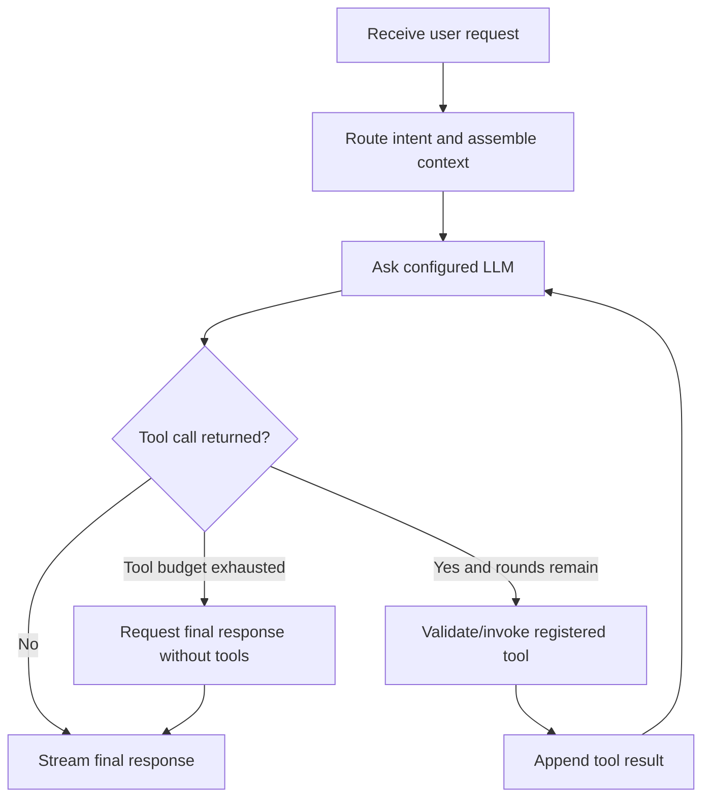

# AIS AI Architecture

## 1. AI Capabilities

Verified capabilities include sustainability question answering, document review, native text extraction, selective OCR, local knowledge-base retrieval, conditional web research, deterministic calculations, uploaded-document term search, response streaming, and source-marker formatting.

## 2. LLM Integration

The integration and prompt-construction layer is in `backend/LLM.py`. The provider is selected with `AIS_PROVIDER` (`openai` or `anthropic`); model names and output/context budgets are configurable. The default model map is defined in code. Credentials are loaded from backend configuration/environment variables and are not documented here.

The orchestration layer assembles a route/intent, task playbook, optional project profile, retrieved evidence, document context, conversation history, and current user message. Streaming is enabled by default and can be configured. Provider calls use a 90-second timeout and up to three client retries. Other stages have explicit timeouts: routing and profile construction, retrieval, and individual tools. Errors may be logged and a stage may fall back to consulting behavior or continue without optional web evidence.

## 3. Prompt Structure

The assembled request can include:

1. System-level instructions and a task playbook.
2. Project profile fields when applicable.
3. Knowledge-base/web evidence, labelled as retrieved and untrusted.
4. Uploaded document context, labelled as untrusted content.
5. Relevant recent history.
6. Current user message.
7. Tool calls/results in additional model turns.

Prompt text is constructed in the backend. This document does not publish private prompt text or credentials.

## 4. Knowledge Base and Retrieval

- Source material is chunked into text passages (default chunk size 1,800 characters with 200-character overlap) and stored in a local SQLite FTS5 index.
- Chunks have title, framework, version, and source metadata.
- Queries are lexical FTS5 searches with BM25 ranking; framework filters can be applied and a fallback search may remove the filter if no matches are found.
- This is not vector search. No embedding generation or vector database was identified.
- Web passages are combined with local passages, deduplicated, and fitted to a character budget.
- Source passages are numbered in prompt context and used by the response-source formatter.
- Source ingestion approval, provenance validation, and index-release governance are **To be confirmed by the AIS team**.

## 5. Document and OCR Processing

PDF processing extracts native text page-by-page first. OCR selection is then determined by existing page-level checks, including bad-character ratio, low native text in pages with images/drawings, and a document-relative Arabic-script outlier check. The selected page is rendered and sent to OCR; valid native pages are not deliberately OCRed by this path. A configurable page cap applies.

RapidOCR is first in the default backend list; Tesseract is an optional fallback if installed and configured. OCR output is normalized into text and associated with original page numbering. Rendering uses available PDF libraries; OCR is local to the backend process (no hosted OCR API was identified). Failures are recorded as extraction warnings/page outcomes, and the overall document task records failed extraction if no readable text remains.

## 6. Web Search

Tavily is the configured web-search provider. Search can be off, always on, or automatic. Automatic search is considered for freshness requests and weak local evidence with framework context. Query text is sent to Tavily; results are filtered by relevance score and primary-domain preference, with an open-web secondary fallback. Search has a 25-second timeout at evidence assembly, and results are treated as untrusted context. Citation markers are generated from the assembled passage order; they do not prove that each claim is correctly supported.

## 7. Agentic Loop

AIS has a bounded model-driven tool loop for registered tools. The model selects a tool call, the backend invokes it, and the result is added to context for another model turn. `AIS_MAX_TOOL_ROUNDS` defaults to four. Each tool invocation has a 15-second timeout. After the tool budget is exhausted, orchestration requests a final answer without further tools. This is not an unlimited autonomous planning loop.

The system has no general-purpose shell, code-execution, arbitrary filesystem, or email-sending tool in the active chat tool registry. Human approval is not implemented for the read/search/calculator calls; there are no verified consequential external write actions in that registry. A separate legacy `bd:` route invokes ContactOut search when enabled.

## 8. AI Limitations

- Model answers may be incorrect, incomplete, or unsupported.
- Retrieved standards may be the wrong version or jurisdiction.
- Lexical retrieval can miss relevant passages that do not share query terms.
- OCR may misrecognize text, tables, unusual fonts, or page layouts.
- A search-result URL or citation marker does not guarantee source correctness.
- Web evidence can be outdated, incomplete, or adversarial.
- Uploaded files and retrieved passages are untrusted inputs and may contain prompt injection.
- The assistant is not a substitute for professional engineering, regulatory, legal, or certification review.

