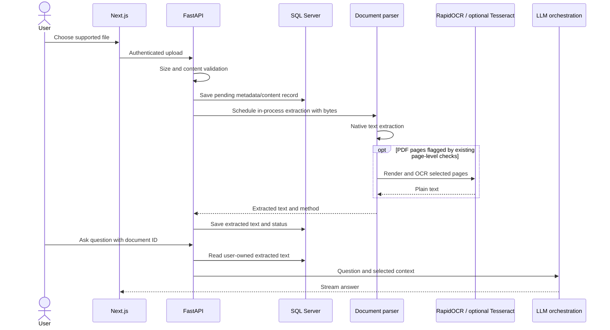
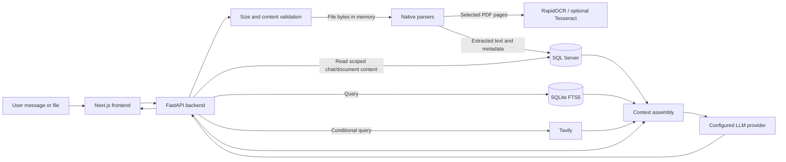

# AIS Data Flow

## 1. Purpose

This document describes how information is collected, validated, transmitted, processed, stored, retained, and deleted in the repository implementation.

## 2. Information Users Can Upload or Submit

The document analyzer recognizes PDF, DOCX, XLSX, XLS, PPTX, PPT, common image formats, SVG, TXT, CSV, JSON, Markdown, HTML, XML, and RTF. The upload route enforces a default maximum of 200 MB (`MAX_UPLOAD_MB` is configurable) and validates content signatures where available. DOCX packages receive additional ZIP/package checks. Plain-text formats receive a lightweight printable-character check. If the optional magic-byte library is unavailable, the validator falls back to trusting the filename extension for file types that depend on it.

| Input | Purpose and processing | Storage and retention |
|---|---|---|
| Chat message | Routed and used to construct an AI request; user/assistant messages are written to SQL Server. | Message content is encrypted only if a valid `ENCRYPTION_KEY` is configured. Chat retention/purge rules apply. |
| PDF | Native page text extraction first; selected pages may be rendered and OCRed. | Extracted text is saved as document content. Upload bytes are held in memory for processing; the upload route does not persist them as raw bytes. |
| Scanned/image-only PDF pages | Page-level low-text/image/drawing detection can select pages for OCR. | OCR text forms part of the extracted document content stored in SQL Server. |
| Office documents, images, and supported text formats | Parsed by available Python libraries or OCR where supported by the implementation. | Extracted text and document metadata are stored in SQL Server. |
| Sustainability/project details in chat | Used as prompt/context data and may update in-process project memory. | Persistent chat messages are stored; profile/memory lifetime beyond a process/session is **To be confirmed by the AIS team.** |

The upload handler does not pass `raw_bytes` to `save_document`; the optional database columns and raw-file route do not establish that newly uploaded originals are retained. Temporary-file behavior depends on the parser/renderer paths and is **To be confirmed by the AIS team** for each dependency/runtime. No durable blob store or embedding store was identified.

## 3. Data Stored by AIS

| Data category | Purpose and storage | Access and deletion |
|---|---|---|
| User/account identifiers and authentication records | SQL Server; account management and authorization. | Authenticated backend operations; user deletion/retention policy is **To be confirmed by the AIS team.** |
| Access/refresh token records | SQL Server token table where token persistence succeeds; JWTs are also held in HttpOnly cookies. | Token validity/revocation checks in backend paths; expiry is configured. |
| Chat metadata and titles | SQL Server. | User-scoped chat queries; deletion initially soft-deletes, then retention cleanup purges. |
| User and assistant messages | SQL Server `Messages`. | Ownership checks; content encryption depends on valid `ENCRYPTION_KEY`; purge with chat. |
| Document filename, extension, method/status, MIME and extracted text | SQL Server `chat_documents`. | User/chat ownership checks; content encryption depends on key configuration; purge with chat. |
| Original uploaded file bytes | No durable storage is established by the current upload call. An optional raw-byte column exists but the upload route does not populate it. | End-to-end original-file retention/deletion is **To be confirmed by the AIS team**; do not assume the raw endpoint can serve new uploads. |
| Knowledge-base chunks and source metadata | Local SQLite FTS5 database file. | Retrieval by backend; ingestion ownership, deployment persistence, backups, and retention are **To be confirmed by the AIS team.** |
| Web-search cache | In-process cache keyed by query, with a six-hour TTL; cache resets with process restart. | No cross-user cache partition or persistent search-result database was identified. |
| Operational logs | Backend logs include selected user IDs, filenames, document/chat IDs, MIME values, processing status, errors, truncated WebSocket input (first 200 characters), evidence counts, and token usage metadata. | Log destination, access controls, retention, and redaction policy are **To be confirmed by the AIS team.** |
| Embeddings, user feedback, and analytics | No vector/embedding store, feedback store, or analytics integration was identified in the reviewed paths. | **To be confirmed by the AIS team** if provided by infrastructure outside this repository. |

## 4. Data Sent to the LLM

Depending on the request and selected path, the backend can send:

- The user’s current question and system/task instructions.
- Relevant recent conversation history, when routing identifies a follow-up or document context is used.
- Extracted text/context from attached or previously referenced documents.
- Passages retrieved from the local SQLite FTS5 knowledge base.
- Tavily search passages, if search is enabled and triggered.
- Results from calculators or the uploaded-document search tool, which are fed back into model context.
- Structured project/context fields assembled from the conversation.

The exact prompt is constructed in the backend AI orchestration layer. General data-loss-prevention redaction of all personal or confidential content before model submission was not verified. Optional moderation/PII-related code is not evidence of comprehensive redaction. Users should avoid submitting information that is unnecessary for the question. Provider-side retention/training settings and contractual terms are **To be confirmed by the AIS team.**

## 5. Document-Processing Flow

The PDF detector considers unreadable-character ratios, low-text pages with images/drawings, and an Arabic-script outlier heuristic. OCR is capped by `PDF_OCR_MAX_PAGES` (default 200). The default OCR backend order is RapidOCR followed by Tesseract; individual backends are configurable. OCR failures are reported as warnings/page outcomes rather than requiring every page to be OCRed. The upload background task uses FastAPI `BackgroundTasks`, not a durable queue.

## 6. Document Retention and Deletion

- Extracted document text and metadata are retained in SQL Server while the associated chat record exists.
- Chat deletion is initially soft deletion. The daily cleanup job permanently removes chats soft-deleted for more than seven days and also purges non-deleted chats older than the configured `CHAT_HISTORY_DAYS` threshold (default 90 days), along with associated messages and document records.
- No separate user-facing document-delete route was identified in the document router.
- Original uploaded files are not passed to persistent raw-byte storage in the upload route.
- Temporary copies, database backups, knowledge-base source-file retention, and administrative deletion procedures are **To be confirmed by the AIS team**.

## 7. Web-Search Data Flow

When enabled, the backend sends the routed query (standalone query when available) to Tavily. In automatic mode, search is considered when fresh information is requested or local evidence is weak for a framework-aware query; it can also be configured always/off or explicitly requested. Tavily is first queried with configured primary domains and may be queried again without that domain restriction for lower-trust fallback results. Results below a score threshold are discarded; returned passages are deduplicated and truncated to context budgets before prompt construction.

Search calls have a 25-second orchestration timeout. Search errors are logged and treated as unavailable evidence for that turn. Query-keyed search results are cached in process for six hours. Search queries/results may appear in provider-side records; provider retention details are **To be confirmed by the AIS team**. Source labels and URLs are mapped to citation markers in assistant responses; citation correctness is not independently guaranteed.

## 8. Data-Flow Diagram

