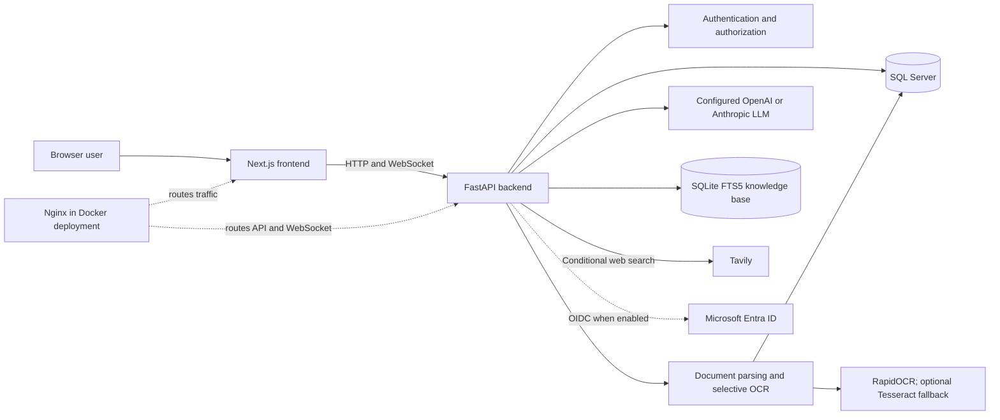

# AIS System Architecture

## 1. Purpose

This document describes the main AIS application components and their verified connections. It describes the repository implementation and deployment instructions, not the status of any running environment.

## 2. System Context

AIS is used through a browser-based Next.js application. The frontend communicates with a FastAPI backend over HTTP and WebSocket connections. The backend handles authentication, chat, document processing, retrieval, and orchestration of configured AI services.

| System or service | Verified role |
|---|---|
| Browser and Next.js frontend | User interface, authentication flows, document upload, chat display. |
| FastAPI backend | REST and WebSocket endpoints for auth, chats, documents, and AI responses. |
| SQL Server | Application accounts, tokens, conversations, messages, document metadata and extracted text. |
| SQLite FTS5 | Local lexical index of knowledge-base chunks; not a vector database. |
| LLM provider | OpenAI or Anthropic, selected in backend configuration. |
| Search provider | Tavily, when configured and selected by the evidence policy. |
| Document-processing libraries | Local Python libraries for document parsing and OCR; RapidOCR is preferred by the default OCR-backend order and Tesseract may be a fallback. |
| Microsoft Entra ID | OIDC identity provider when production SSO is enabled. |
| Azure App Service | A sidecar deployment procedure is documented in `AZURE_DEPLOYMENT_GUIDE.md`; deployment state is not established by source code. |

The upload route passes file bytes to an in-process background extraction task and does not pass the original bytes to the database save operation. Durable original-file or blob storage is therefore not established by the upload implementation. No Azure Blob Storage integration was identified.

## 3. Main Components

| Component | Purpose and responsibilities | Main inputs | Main outputs | Connected services |
|---|---|---|---|---|
| Next.js frontend | Registration/login, chat, document upload, status polling, and rendering responses. | User input, selected documents, API responses. | HTTP requests, WebSocket messages, rendered UI. | FastAPI backend; browser. |
| FastAPI API | Authentication, authorization checks, chat/document APIs, WebSocket chat, validation, and service orchestration. | Cookies, API payloads, upload bytes, chat messages. | API responses, document records, streamed AI responses. | SQL Server, local file-processing libraries, LLM, knowledge base, optional Tavily. |
| Authentication services | Local account and Microsoft OIDC flows; JWT cookie and WebSocket ticket handling. | Credentials or OIDC callback, cookies, CSRF header. | Authenticated identity and session cookies/tickets. | SQL Server, Microsoft Entra ID when enabled. |
| Chat and AI orchestration | Builds prompts/context, retrieves evidence, invokes approved tools, streams model output. | User query, conversation history, document context. | Assistant text and source references. | LLM provider, SQLite FTS5, optional Tavily, deterministic calculators. |
| Document analysis | Validates file content, extracts text, selectively OCRs PDF pages, records status and extracted text. | Uploaded bytes and filename. | Extracted text, method/status, warnings. | Python parsing libraries, RapidOCR, optional Tesseract, SQL Server. |
| SQL Server database | Persistent application records. | Account, token, chat, message, document metadata/content operations. | Records scoped to authenticated users. | FastAPI backend. |
| SQLite FTS5 knowledge base | Stores indexed text chunks with source/framework/version metadata and returns lexical matches. | Ingested source text and query terms. | Ranked passages. | AI orchestration. |
| WebResearcher | Optional web evidence retrieval with Tavily. | Query derived from the request. | Filtered search-result passages with URLs. | Tavily and AI orchestration. |
| Docker/Nginx/Azure configuration | Reference local container routing and documented Azure sidecar deployment. | Container images and runtime configuration. | Routed frontend/API traffic. | Docker; proposed Azure App Service target. |

## 4. Architecture Diagram

The Nginx component is used by the documented Docker deployment. Local development can route through Next.js rewrites and does not require Nginx.

## 5. Deployment Architecture

Repository deployment documentation describes:

- Local development with the Next.js and FastAPI processes running separately.
- Docker Compose with Nginx as the entry point and frontend/backend containers.
- A proposed Azure App Service sidecar deployment with Nginx as the main container and frontend/backend sidecars.
- Runtime settings injected through environment variables/App Service settings in the documented Azure procedure.

The repository does not prove that the documented Azure resources, network controls, database, monitoring, or image versions are currently deployed. Production topology, subnet/private endpoint use, backups, Azure Key Vault use, centralized monitoring, and deployed service health are **To be confirmed by the AIS team.**

## 6. Trust Boundaries

1. **User device ↔ frontend:** browser content and uploaded files originate outside AIS.
2. **Frontend ↔ backend:** HTTP/WebSocket requests cross the application boundary; authentication cookies and CSRF controls apply to relevant routes.
3. **Backend ↔ SQL Server:** account, chat, message, and document records cross the application/database boundary.
4. **Backend ↔ local processing:** untrusted files are parsed and rendered by backend libraries.
5. **Backend ↔ LLM provider:** prompt, relevant history, selected document text, retrieved evidence, and tool results may be sent externally.
6. **Backend ↔ Tavily:** selected user-derived query text is sent when web search is enabled and triggered.
7. **Backend ↔ Microsoft Entra ID:** OIDC data is exchanged when real SSO is enabled.
8. **Backend ↔ Azure/runtime services:** deployment and secret-management details beyond repository configuration are **To be confirmed by the AIS team.**

## 7. Dependencies

- Next.js frontend; FastAPI and Python backend.
- SQL Server via ODBC Driver 18.
- SQLite FTS5 for the knowledge base.
- LangChain provider integrations and configured OpenAI or Anthropic model clients.
- Tavily Python client for optional search.
- PyMuPDF, pdfplumber, PyPDF2, office-document parsers, image libraries, RapidOCR/ONNX Runtime, and optional pytesseract/Tesseract for supported extraction paths.
- Microsoft Entra ID OIDC when configured.
- Docker and Nginx for the documented container deployment.

For deployment details, see [the existing system architecture document](../../SYSTEM_ARCHITECTURE.md) and [Azure deployment guide](../../AZURE_DEPLOYMENT_GUIDE.md).

