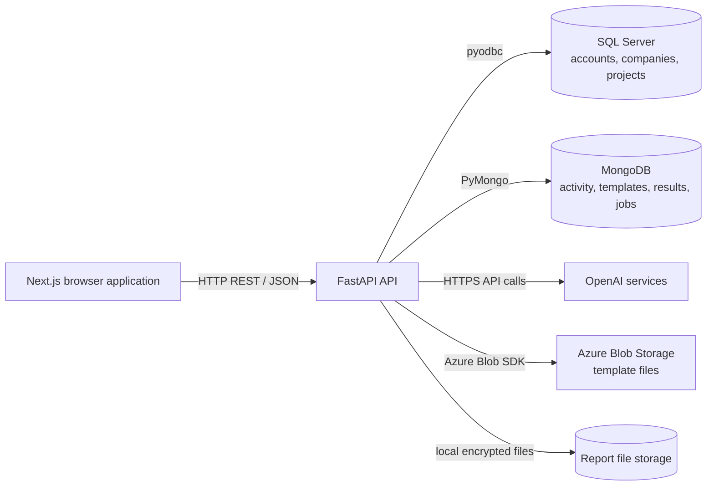
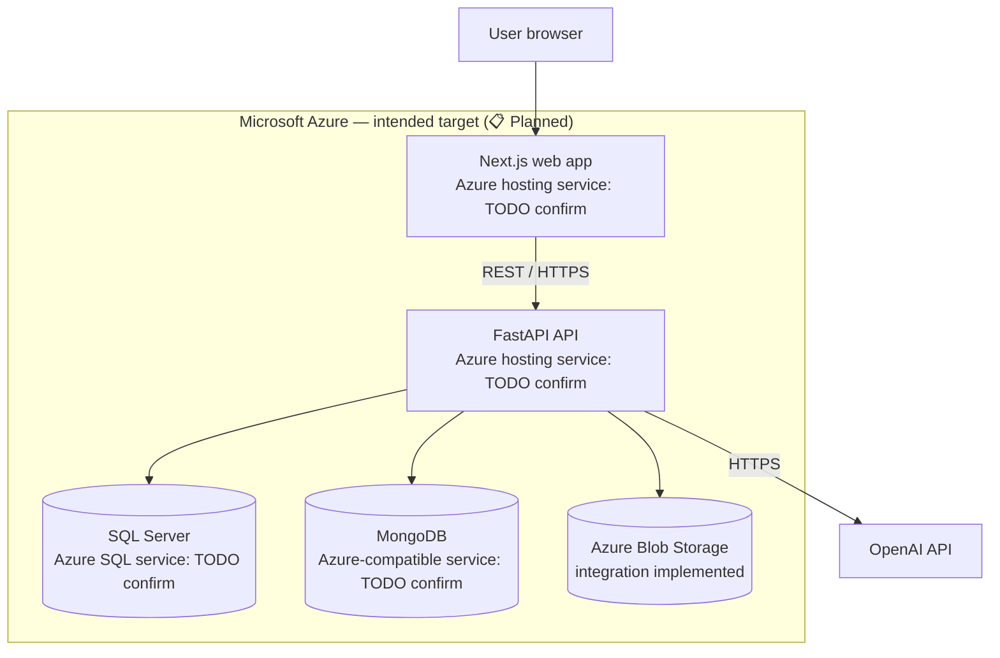

# Carbon Emission Intelligence Platform

Purpose: Introduce the project, its current capabilities, setup constraints and technical documentation.

The Carbon Emission Intelligence Platform is a full-stack application for organizing company and project data, importing emissions activity, storing category-level results, exploring dashboards, and generating AI-assisted GHG methodology reports. A Next.js frontend communicates with a FastAPI backend, which uses SQL Server for core account and project records and MongoDB for emissions, templates, and report-job documents. **The repository is an active development project, not a finished product.**

> **Status: In active development. Scope 3 and commercial features are not yet implemented.**

The project remains 🚧 **in active development**.

## Feature status

| Feature | Status | Notes |
|---|---|---|
| User authentication, profiles, company and project management | ✅ Implemented | JWT-based authentication and role checks exist; see [Security overview](docs/security-overview.md). |
| Emissions data import and review | ✅ Implemented | Workbook-based template upload, validation, preview/confirmation and MongoDB persistence exist. |
| Scope 1 and Scope 2 data/results | ✅ Implemented | The code supports Scope 1/2 categories and stores emission results. Calculation provenance and exact category equations are not uniformly confirmed. |
| Dashboards and emissions reports | ✅ Implemented | API and frontend modules provide company, project, scope, category and period views. |
| AI-assisted form suggestions and report drafting | ✅ Implemented | OpenAI calls are server-side and use preset prompts with supplied context. |
| Scope 3 emission calculation and ingestion | 📋 Planned | Scope 3 is not implemented as an emissions-calculation feature. |
| Commercial features (pricing, plans, billing, subscriptions) | 📋 Planned | No commercial workflow is implemented. |
| Azure hosting for web apps and databases | 📋 Planned | Intended deployment target for the Next.js frontend, FastAPI API, SQL Server data and MongoDB data. Azure service choices and deployment configuration are not yet defined in the repository. |
| Docker packaging | 📋 Planned | No Dockerfile or Compose configuration is present. |

## Technology stack

| Area | Technology evidenced in repository |
|---|---|
| Web frontend | Next.js 16, React 19, TypeScript, Tailwind CSS |
| API | FastAPI, Python, Pydantic |
| Relational data | Microsoft SQL Server via `pyodbc` |
| Document data | MongoDB via PyMongo |
| Authentication | JWT bearer tokens; bcrypt password utilities |
| AI | OpenAI Chat Completions (`gpt-4o-mini`) for suggestions; LlamaIndex OpenAI client (`gpt-4o`) for report sections |
| Reporting | DOCX/PDF-related code; report service currently disables PDF output and builds Word reports |
| Cloud integration | Azure Blob Storage SDK for retrieving templates |
| Deployment target | Microsoft Azure for the frontend, API and both databases (📋 Planned; service selections are TODO: confirm) |
| Containers / deployment | 📋 Planned — no Dockerfile, Compose file, Azure deployment definition, or CI workflow was found |

## High-level architecture



The diagram shows integrations identified in code. It does not imply a deployed topology.

### Intended Azure deployment target

The intended deployment is to host the **Next.js web app, FastAPI API, SQL Server database and MongoDB database on Azure**. This is 📋 Planned, not deployed or configured in the repository. The specific Azure hosting and database products remain **TODO: confirm**.



## Repository structure

```text
Backend/
  app/api/          FastAPI routers
  app/models/       Pydantic request, response and document models
  app/repositories/ SQL Server and MongoDB access
  app/service/      Import, calculation-adjacent, dashboard and reporting services
  storage/          Templates and report files
  tests/            Backend tests
Frontend/
  app/              Next.js App Router pages and API route handlers
  components/       UI components, charts and report forms
  lib/              Frontend API clients and helpers
  public/           Static assets
SQL/                SQL Server backup artifact (not a documented migration/schema)
mongo database/     MongoDB BSON export artifacts; do not publish as sample data
docs/               Project documentation
```

## Getting started

### Prerequisites

- Node.js and npm compatible with the frontend package manifest.
- Python and the backend dependencies required by the source.
- A reachable SQL Server and MongoDB instance, plus any external services needed by the feature being exercised.
- Appropriate development-only credentials, configured outside source control.

**TODO: confirm** the supported Python version, backend dependency installation procedure, SQL Server schema/migrations, and the complete local service setup. No backend dependency manifest or schema migration set is tracked.

### Environment variable names

Use variable names only in documentation; supply values through your local secret store or ignored environment files. Names observed in code include:

`JWT_SECRET`, `JWT_ALGORITHM`, `ACCESS_TOKEN_EXPIRE_MINUTES`, `PASSWORD_RESET_EXPIRE_HOURS`, `OPENAI_API_KEY`, `REPORT_ENCRYPTION_KEY`, `REPORT_TOKEN_SECRET`, `AZURE_STORAGE_CONNECTION_STRING`, `AZURE_STORAGE_CONTAINER_NAME`, `FRONTEND_RESET_PASSWORD_URL`, `SMTP_PASSWORD`, and `REDIS_HOST`, `REDIS_PORT`, `REDIS_PASSWORD`, `REDIS_DB`, `REDIS_SSL`, `REDIS_SOCKET_CONNECT_TIMEOUT`, `REDIS_SOCKET_TIMEOUT`, `REDIS_RETRY_ON_TIMEOUT`.

SQL Server and MongoDB connection configuration is currently hardcoded in source rather than consistently read from these variables. Do not copy source configuration values into public documentation.

### Run locally

The frontend has a documented npm development script:

```powershell
cd Frontend
npm install
npm run dev
```

Backend local command: **TODO: confirm** the backend dependency/bootstrap instructions and supported launch command; the application entry point is `Backend/app/main.py`.

### Docker

🚧 **No Dockerfile or Docker Compose configuration is present.** The application cannot currently be started through a repository-provided Docker workflow. Containerization is 📋 Planned and may support the intended Azure deployment.

## Documentation

- [System architecture](docs/system-architecture.md)
- [Data flow](docs/data-flow.md)
- [Security overview](docs/security-overview.md)
- [AI architecture](docs/ai-architecture.md)
- [Data model](docs/data-model.md)
- [API reference](docs/api-reference.md)
- [Emissions methodology](docs/emissions-methodology.md)
- [Roadmap](docs/roadmap.md)
- [Deployment](docs/deployment.md)
- [AI readiness](docs/ai-readiness.md)

## Limitations and not-yet-implemented work

- **Scope 3:** 📋 Planned. Scope 3 appears in report schemas, prompts, validation and charts, but those references do not demonstrate implemented Scope 3 data ingestion or calculation. Do not treat generated Scope 3 text/results as validated inventory data.
- **Commercial side:** 📋 Planned. Pricing, plans, billing, subscriptions and commercial multi-tenancy are not implemented.
- **Deployment:** 📋 Planned. The target is Microsoft Azure for the Next.js frontend, FastAPI API, SQL Server and MongoDB data stores. Hosting/database product selections, networking, CI/CD and deployment configuration are not yet defined in the repository. Azure Blob Storage integration is implemented for template file retrieval.
- **Security and configuration:** connection settings need to be moved to external configuration and reviewed before production; see [Security overview](docs/security-overview.md).

<!-- Add a reviewed, non-sensitive screenshot at docs/images/dashboard.png before publishing. -->

