Purpose: Describe the AI capabilities currently implemented and the operational work needed to use them reliably.

Status: In active development. Scope 3 and commercial features are not yet implemented.

## Current AI features

| Capability | Status | Implementation |
|---|---|---|
| Form-field suggestions | ✅ Implemented | `POST /api/assistant/suggest` selects a fixed prompt template and makes an authenticated server-side OpenAI Chat Completions call using `gpt-4o-mini`; output is parsed as a JSON options list. |
| Methodology-report sections | ✅ Implemented | Report service assembles structured report data from request values and database-derived emissions context, then generates sections with the LlamaIndex OpenAI client using `gpt-4o`. |

## Active report generation path

```mermaid
flowchart LR
    Request[Report request and selected project data] --> Assemble[Merge structured request context with DB aggregates]
    Assemble --> Validate[Pre-generation validation and KPI checks]
    Validate --> Compact[Select relevant context per report section]
    Compact --> Prompt[System style, section instructions, JSON context]
    Prompt --> Model[OpenAI gpt-4o through LlamaIndex]
    Model --> Check[Post-generation placeholder/numeric consistency checks]
    Check --> DOCX[Word report builder]
    DOCX --> Encrypt[Encrypt file and store locally]
    Encrypt --> Download[Status and time-limited download]
```

The report prompt requests evidence-based writing based on supplied data, explicit limitations and no invented numeric values. Code validates report totals and placeholder leakage in parts of the pipeline. These controls reduce risk but do not guarantee factual correctness or independent verification.

## Prompts and context handling

- Field suggestions accept a field identifier and a context dictionary, but the backend only supports enumerated prompt-template keys. Prompts request short options and constrain statements not to invent beyond supplied context.
- Report data may include organization and boundary details, scope totals, category values, methodology, assumptions, exclusions, emission-factor sources, QA limitations, references, prior-year data and trends.
- The report service may use request-provided results or fall back to DB-derived dashboard/category data.
- Section generation compacts the context to data relevant to each section and provides system instructions emphasizing traceability and no fabricated numbers.
- External model calls receive the prompt/context. **TODO: confirm** provider data-retention terms, regional processing and contractual controls before using personal, confidential or regulated data.

## Current capability boundaries

Both AI features call language models using prompt templates and context supplied by the application. Report drafting can use structured organization and emissions data assembled from the request and database. Suggestions use selected form fields and context. Neither feature should be treated as an authoritative source of emissions data or as a substitute for expert review.

## Evaluation and limitations

✅ Implemented: report validation checks data shape/totals and placeholder leakage; tests cover selected report defects and validator behavior.

🚧 In progress: automated model-quality evaluation, golden datasets, prompt-injection testing, fact-checking against calculation records, hallucination measurement and model/version monitoring are not established in the repository.

Known limitations:

- LLM output can hallucinate or overstate the underlying data despite prompt instructions and checks.
- The model sees the structured context passed for the request plus its pretrained knowledge; generated statements are not independently verified against original activity data and calculation records.
- Database freshness, emission-factor validity dates and provenance are dependent on input/source records.
- Report schemas and prompts include Scope 3 data fields, but Scope 3 emission calculation is not implemented. Generated prose must not be considered evidence of Scope 3 coverage.
- **TODO: confirm** approved model versions, evaluation thresholds, human review requirements and monitoring/incident process.
