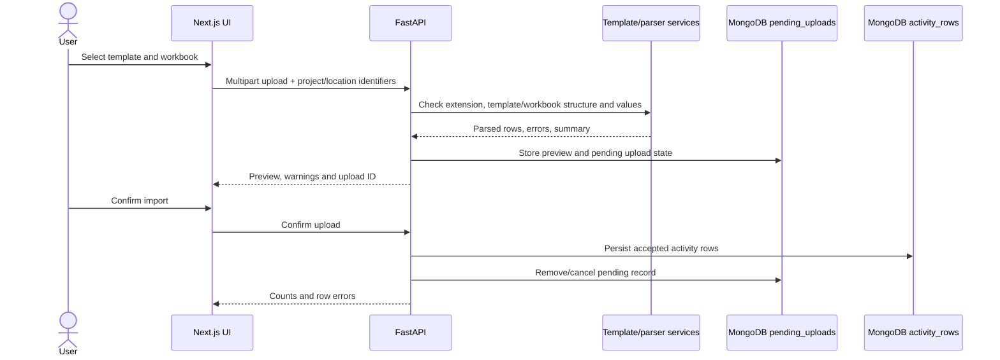
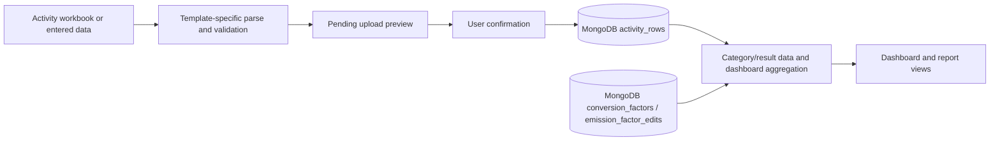
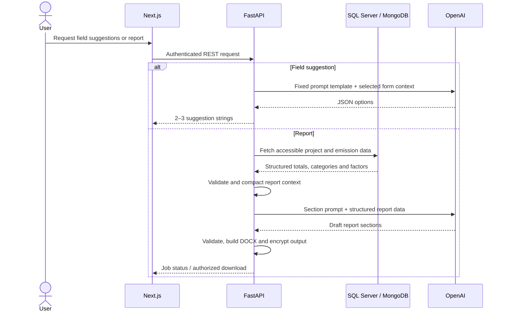

Purpose: Explain how user-submitted records move through import, storage, dashboard and AI reporting paths.

Status: In active development. Scope 3 and commercial features are not yet implemented.

## Data ingestion

The workbook path below is implemented for supported templates and process-emissions uploads. A general-purpose Scope 1/2 emissions importer for every category is **TODO: confirm**; the repository has multiple upload/template flows and their coverage varies.

For supported Excel templates, code normalizes headers/text, checks required workbook structure and numeric values, captures template version/checksum, and reports validation errors. Process-emissions upload accepts `.xlsx` files, extracts activity data and totals from workbook cells, and enforces non-negative activity and total emissions. The values are read from prepared workbook contents; this is not proof that the backend recomputes every formula independently.

## Emission result flow

Only Scope 1 and Scope 2 are in implemented emission-data scope. Process uploads shown in `emissions_routes.py` set `scope_number` to `1`; stored row models include activity, factor provenance, component gas emissions and CO2e. Do not infer a universal calculation equation from that schema. The process-upload service extracts totals from workbook summary cells. The standalone report builder also computes a Scope 2 electricity result as `kWh × kgCO2e/kWh ÷ 1,000` for tCO2e, if both values are supplied.

📋 **Scope 3 calculation is not implemented.** Scope 3 report fields and category logic are not equivalent to implemented ingestion/calculation. See [Emissions methodology](emissions-methodology.md).

## AI-assisted field suggestion and report generation

The current AI path sends application-supplied context to a language model using preset prompts. The model response is parsed or validated by the calling service, then returned to the frontend or included in a generated report. See [AI architecture](ai-architecture.md).

## Reporting and dashboard

Dashboard requests use authenticated API endpoints with company/project and optional date/period filters. Repository services aggregate stored activity/results and return KPIs, trends, scope contribution, category hotspots, gas composition or comparison data. The frontend renders these via chart and table components.

Report generation validates a request, checks accessible project IDs, creates a report-job document, and schedules background generation. Report context can merge request-supplied results with dashboard/MongoDB data. Status/download endpoints expose job progress and a time-limited token; generated files are encrypted on local disk. PDF generation is currently disabled in the report service; Word document generation is active.

## Storage map

| Data | Current location | Reason evidenced by usage |
|---|---|---|
| User, company, project, company-year and location records; refresh tokens | SQL Server | Relational repositories perform CRUD and joins. |
| Activity rows and nested activity/factor/emission values | MongoDB `activity_rows` | Variable input rows and nested calculation metadata. |
| Scopes, categories, category results, templates, pending uploads, reports and factor edits | MongoDB collections | Document-oriented repositories use these names and nested payloads. |
| Conversion factors | MongoDB `conversion_factors` | Factor repository searches document records. |
| Template workbooks | Azure Blob Storage for downloads; repository template metadata in MongoDB | Download service resolves blob key from template metadata. |
| Generated report files | Local `Backend/storage/reports`, encrypted | Report service encrypts and stores generated files on the backend filesystem. |

**TODO: confirm** canonical ownership and retention rules for upload data, calculation results, and report documents.
