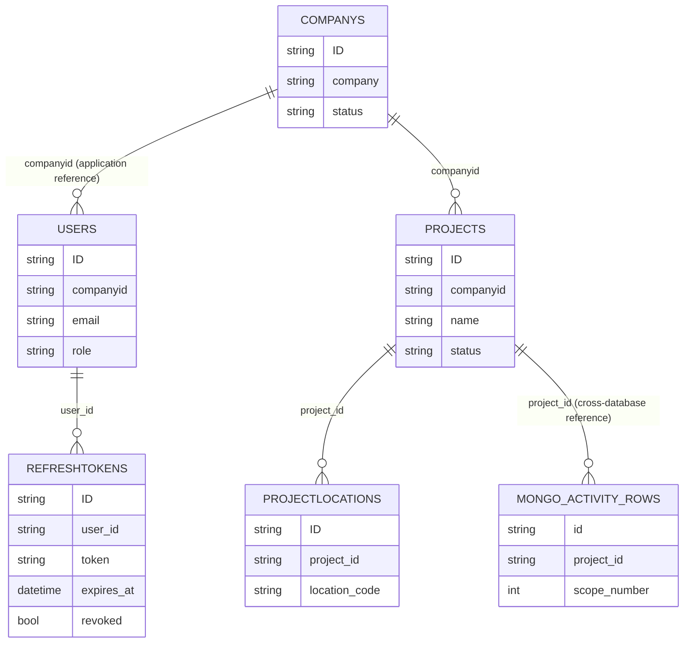

Purpose: Record the relational entities and MongoDB document shapes visible in application code.

Status: In active development. Scope 3 and commercial features are not yet implemented.

## SQL Server

The repository uses SQL queries rather than a checked-in ORM schema or migration set. The following columns are evidenced in model fields and SQL statements; this is **not** a complete physical schema. **TODO: confirm** SQL types, nullability, defaults, unique constraints, actual primary/foreign keys, and any columns hidden in `SELECT *` or database-only DDL.

| Table | Columns evidenced in code | Keys / relationships evidenced |
|---|---|---|
| `Users` | `ID`, `username`, `email`, `password`, `firstname`, `lastname`, `phone`, `role`, `companyid`, `projectsid`, `createdate`, `lastlogin`, `DOB`, `address`, `nickname`, `note`, `permeation`, `isdelete`, `is_active` | `ID` used as user identifier. `companyid` associates a user with `Companys.ID`; exact SQL constraints are TODO. |
| `Companys` | `ID`, `company`, `date`/creation date, `approved`, `approveddate`, `description`, `phone`, `website`, `address`, `branchsid`, `plantype`, `renewaldate`, `base_year`, `note`, `email`, `country`, `status`, `sectorid`, `number_of_employees`, `isdelete` | `ID` used as company identifier; project/user records refer to it by ID. No commercial plans or billing schema evidenced. |
| `Projects` | `ID`, `name`, `date`, `done`, `isdelete`, `edit`, `approveddate`, `editby`, `companyid`, `usersids`, `quotation`, `note`, `created_by`, `created_at`, `approved`, `approved_by`, `status` | `companyid` joined to `Companys.ID`; project ID is referenced from MongoDB activity documents. |
| `RefreshTokens` | `ID`, `user_id`, `token`, `expires_at`, `revoked` | `user_id` associates with `Users.ID`; application queries also use token value. |
| `CompanyYears` | `ID`, `Company_ID`, `Year` (plus additional fields used by repository writes) | Company/year uniqueness is checked in repository logic; exact DB constraint and full columns **TODO: confirm**. |
| `ProjectLocations` | `ID`, `project_id`, `location_code`, `country`, `city`, `address` (repository selects additional fields) | `project_id` refers to `Projects.ID`; actual FK constraints **TODO: confirm**. |
| `ProjectLocationYears` | Table is referenced by repository updates. | Full column and key definitions **TODO: confirm**. |

### Relationship diagram



The diagram represents application-level references only; do not infer database-enforced constraints.

## MongoDB collections

Collection names observed in repositories include:

| Collection | Purpose inferred from access patterns |
|---|---|
| `activity_rows` | Imported/entered activity records, values, provenance, optional factors and emissions |
| `category_emission_results` | Aggregated category totals and calculation metadata |
| `category_instances`, `scope_instances` | Project scope/category configuration |
| `conversion_factors` | Searchable factor records |
| `emission_factor_edits` | User-edited factors/reference metadata |
| `pending_uploads` | Parsed upload preview pending confirmation |
| `templates` | Template metadata, schema and blob storage key |
| `sheets`, `sheets_data` | Sheet structures and values in legacy/parallel sheet paths |
| `report_jobs` | Report job state, metadata and encrypted-file key/hash |

The following examples are **synthetic schema sketches** based on Pydantic models/repository access; they are not exported production records.

### `activity_rows` (sketch)

```json
{
  "id": "sample-row-001",
  "project_id": "sample-project",
  "scope_id": "sample-scope",
  "scope_number": 1,
  "location_code": "SITE-A",
  "category_key": "stationary-combustion",
  "year": 2025,
  "sheet_name": "Activity",
  "import_category": "Stationary Combustion",
  "data": { "activity": 1250, "unit": "L" },
  "created_by": "sample-user",
  "validation_passed": true,
  "calculation": {
    "formula_version": 1,
    "calculated_at": "2025-01-01T00:00:00Z",
    "calculated_by": "sample-user",
    "calculation_source": "template"
  },
  "emission_factors": {
    "co2e": {
      "value": 0.0,
      "unit": "kgCO2e/L",
      "source": "sample source",
      "source_reference": "sample reference"
    }
  },
  "ghg_emissions": { "co2e": 0.0, "co2": 0.0, "ch4": 0.0, "n2o": 0.0 },
  "is_deleted": false
}
```

Additional gas-specific factor subdocuments may be required by `ActivityRowEmissionFactors`; example above is illustrative, not a complete valid record.

### `category_emission_results` (sketch)

```json
{
  "id": "sample-result-001",
  "project_id": "sample-project",
  "company_id": "sample-company",
  "scope_instance_id": "sample-scope",
  "category_instance_id": "sample-category",
  "year": 2025,
  "scope": 1,
  "category_key": "stationary-combustion",
  "category_name": "Stationary Combustion",
  "totals": {
    "tonnes_co2e": 0.0,
    "tonnes_co2": 0.0,
    "tonnes_ch4": 0.0,
    "tonnes_n2o": 0.0
  },
  "calculation": {
    "formula_version": 1,
    "calculated_at": "2025-01-01T00:00:00Z",
    "calculated_by": "sample-user"
  },
  "input_summary": { "row_count": 1 },
  "status": "sample"
}
```

## Validation and schema enforcement

- Pydantic validates request/document shapes on typed FastAPI paths. `Company` constrains positive employee counts and base year; `CategoryEmissionResult` requires a positive year.
- Activity rows carry `validation_passed`, `validation_errors`, template version and checksum fields; template upload processing validates workbook structure and field values.
- SQL Server schema constraints are not represented by checked-in migrations.
- MongoDB collection-level JSON Schema validators/index definitions are not present in the inspected application code. Some documents are assembled as dictionaries.
- **TODO: confirm** canonical schema versioning, DB constraints/indexes, retention/soft-delete policy and migration process.
