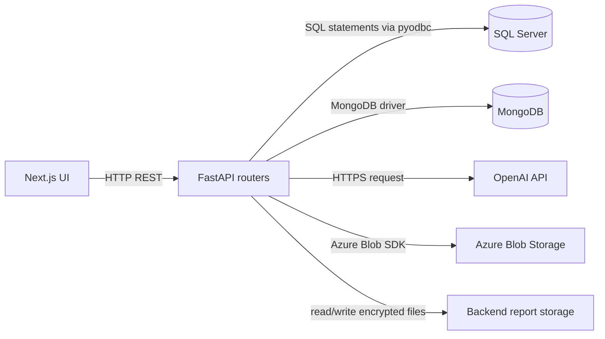
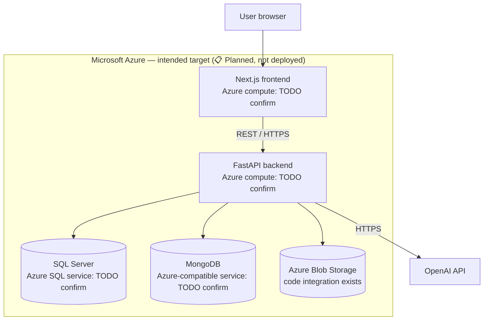

Purpose: Describe the components and integration boundaries evidenced in the repository.

Status: In active development. Scope 3 and commercial features are not yet implemented.

## Components and responsibilities

| Component | Status | Responsibility and evidence |
|---|---|---|
| Next.js frontend | ✅ Implemented | Pages, forms, dashboards, charts and reports under `Frontend/app` and `Frontend/components`; calls backend APIs. |
| FastAPI backend | ✅ Implemented | Mounts authentication, company, user, project, dashboard, scope, template, emissions, report and assistant routers in `Backend/app/main.py`. |
| SQL Server | ✅ Implemented | Accessed with `pyodbc`; repositories use relational records for users, companies, projects, company years, locations and refresh tokens. |
| MongoDB | ✅ Implemented | PyMongo repositories store activity rows, scope/category instances, category results, templates, uploads, reports and factors. |
| OpenAI | ✅ Implemented | Assistant field suggestions use Chat Completions; report section writing uses an OpenAI model through LlamaIndex. |
| Azure Blob Storage | ✅ Implemented | `TemplateDownloadService` reads template blobs using configured Azure Storage credentials and a container name. |
| Azure hosting for frontend, API and databases | 📋 Planned | Intended target for the Next.js web app, FastAPI service, SQL Server and MongoDB. Specific Azure services are TODO: confirm; no infrastructure/deployment configuration is present. |
| Docker | 📋 Planned | No Dockerfile or Compose configuration found. |

## Component diagram

## Intended Azure deployment view

The target reflects the stated deployment intent: frontend, API and both databases are to be hosted on Azure. It is not a deployed architecture. **TODO: confirm** Azure compute services, Azure SQL product, Azure-compatible MongoDB product, network boundaries, TLS termination, regions and environment separation. Current source still uses local/in-source database connection configuration in several places.

## Communication and trust boundaries

- The frontend calls REST endpoints with JSON and, for file imports, multipart uploads. Authenticated calls use bearer JWTs.
- FastAPI depends on `pyodbc` for SQL Server and PyMongo for MongoDB. The repository has direct connection construction in multiple places; not all callers share one configured client.
- The field-suggestion endpoint makes a server-side HTTPS request to OpenAI. Report generation uses the LlamaIndex OpenAI client.
- Template files may be downloaded from Azure Blob Storage. Other report artifacts are written to local `Backend/storage/reports` paths, then encrypted by the report service.
- The code does not establish service-to-service network policies, private endpoints, TLS settings for database connections, or cloud file encryption settings. These remain deployment requirements for the planned Azure environment; **TODO: confirm** production controls.

## SQL Server versus MongoDB

- SQL Server is used for comparatively structured identities and business records, including users, companies, projects, project locations and refresh tokens.
- MongoDB stores variable-shaped and nested records such as activity rows, template schemas, calculation/result documents, pending upload state, report jobs and emission-factor edits.
- Conversion-factor and dashboard/report services also read MongoDB collections. Collection schema/version enforcement is implemented through application models in some paths, not a repository-wide Mongo validation definition.
- These are current usage patterns, not a documented design mandate. No relational DDL or migration history is present. **TODO: confirm** definitive table constraints and ownership rules.

## Scalability and reliability

✅ Implemented: FastAPI rate-limit middleware, bounded OpenAI timeouts in assistant code, report generation as background tasks, a Redis-capable cache with in-memory fallback, and template-upload validation.

🚧 In progress: the in-memory cache is process-local; report jobs and generated files are not shown as a distributed worker/object-storage architecture. Multiple app instances could therefore require coordinated job execution, shared storage and a shared cache.

📋 Planned: define Azure service scaling, health/readiness checks, durable queue semantics, backup/restore, observability and a production deployment topology. **TODO: confirm** expected throughput and recovery objectives.

## Key decisions and trade-offs

- SQL + MongoDB serve different access patterns, at the cost of dual-database operations and coordination.
- Workbook templates support structured, domain-specific inputs but introduce template-version and compatibility dependencies.
- Current AI features generate text from preset prompts and request/database-derived structured context. This limits outputs to the supplied context and the model’s pretrained knowledge, which the application does not independently verify.
- Generated reports are saved to local storage and encrypted, which is useful for a single-host workflow but is not a shared/distributed storage design.
- No Docker/Azure hosting definition means the intended Azure deployment and its operational assumptions remain unverified.
