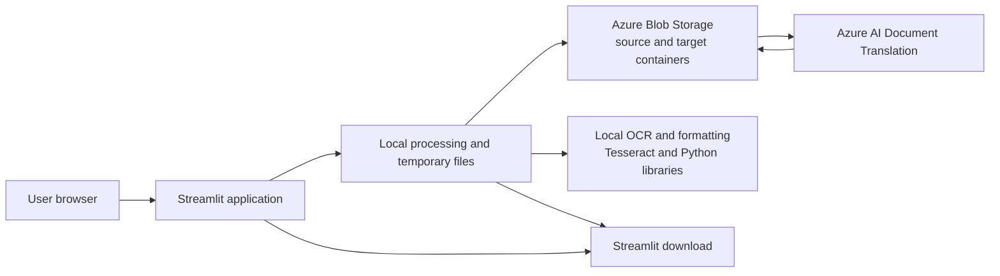

# Alpin Document Translation & OCR

> **Status: In development.** This repository contains a Streamlit document translation and OCR application.

The application is intended to help users translate documents between English and Arabic while retaining document formats. It uses Streamlit for its interface, Azure AI Document Translation for document translation, and Azure Blob Storage as the translation service's source and target storage. It also includes local OCR for scanned PDFs and images. The project is a prototype: several dependencies and deployment settings are incomplete, so the included Docker image is not currently a verified, ready-to-run deployment.

## Features

| Feature | Status | Notes |
|---|---|---|
| Streamlit upload and translation interface | Implemented | Uploads PDF, DOCX, XLSX, and PPTX files. |
| English/Arabic direction selection | Implemented | Detects the source language from extracted text; English maps to Arabic, other detected languages map to English. |
| Azure document translation | Implemented in code | Requires Translator credentials and Azure Blob Storage access. |
| Arabic OCR and searchable PDF output | Partial | OCR code uses Tesseract. Python and system dependencies are not fully included in the project setup. |
| Arabic right-to-left formatting | Partial | Post-processing adjusts selected Word, PowerPoint, and Excel text formatting. |
| Download translated files | Implemented | PDF downloads are offered in a ZIP with a best-effort DOCX conversion. |

## Technology stack

| Area | Technology |
|---|---|
| Language and runtime | Python 3.11 (Docker base image) |
| User interface | Streamlit |
| Document translation | Azure AI Document Translation SDK |
| Temporary cloud file storage | Azure Blob Storage SDK |
| Document parsing and formatting | PyMuPDF, PyPDF2, python-docx, openpyxl, python-pptx |
| OCR | Tesseract via `pytesseract` (external binary and Python dependency need setup) |
| Language detection | `langdetect` |
| Container packaging | Dockerfile is present; runtime configuration needs correction |
| Hosting | Azure hosting is not verified; no Azure deployment or infrastructure configuration is included |

## Architecture



The application communicates with Azure services through their Python SDKs. It does not expose a separate FastAPI or REST API of its own. See [System architecture](docs/system-architecture.md) for details.

## Repository structure

```text
.
├── Code/
│   ├── Alpin_app.py             # Streamlit application entry point
│   ├── main.py                  # Translation orchestration
│   ├── azure_client.py          # Azure Blob Storage operations
│   ├── translation.py           # Azure Document Translation client
│   ├── document_processing.py   # Text extraction and direction formatting
│   ├── pdf_ocr_converter.py     # Scanned-PDF OCR
│   ├── config.py                # Environment-backed configuration
│   ├── requirements.txt         # Python dependencies
│   └── Dockerfile               # Container recipe (entry point currently mismatched)
└── docs/
    ├── ai-architecture.md
    ├── ai-readiness.md
    ├── api-reference.md
    ├── data-flow.md
    ├── data-model.md
    ├── deployment.md
    ├── roadmap.md
    ├── security-overview.md
    └── system-architecture.md
```

## Getting started

### Prerequisites

- Python 3.11 or a compatible version
- Azure AI Translator resource configured for document translation
- Azure Blob Storage account with `source` and `target` containers and suitable SAS permissions
- Tesseract OCR and the language data required by the OCR code if OCR is needed
- Docker only after the image entry point and Linux OCR dependencies have been corrected

### Configuration

`Code/config.py` loads `Code/Transaltion.env` and reads these environment-variable names:

```text
TRANSLATOR_ENDPOINT
TRANSLATOR_KEY
TRANSLATOR_REGION
STORAGE_ACCOUNT_URL
SAS_TOKEN
```

Provide values privately through your local environment or deployment secret store. Do not commit credentials, SAS tokens, account URLs, or real user credentials. `TRANSLATOR_REGION` is read but is not currently used by the translation client.

### Run locally

From the repository root, create and activate a virtual environment, install the declared dependencies plus the two currently omitted Python imports, set the required environment variables, and start Streamlit:

```powershell
cd Code
py -3.11 -m venv .venv
.\.venv\Scripts\Activate.ps1
python -m pip install -r requirements.txt
python -m pip install pytesseract deep-translator
streamlit run Alpin_app.py
```

The OCR module currently sets the Tesseract executable to a Windows-specific path (`C:\Program Files\Tesseract-OCR\tesseract.exe`). Install Tesseract there or update the application configuration for your operating system. The application also expects a `login.yaml` file in its working directory; supply a properly configured, non-public credentials file.

### Run with Docker

Docker packaging is present but **the current image is not ready to run as written**:

- `Code/Dockerfile` starts a missing `setec_app.py`; the actual Streamlit entry point is `Alpin_app.py`.
- The declared Python requirements omit `pytesseract` and `deep-translator`.
- The OCR code hard-codes a Windows Tesseract path, while the image uses a Linux base image; the image also does not install the Tesseract executable.

Therefore a successful `docker run` command cannot be claimed for the checked-in image. Correct the entry point and install/configure the Linux OCR dependencies before publishing or deploying it. Supply Azure configuration and authentication data at runtime using a secret manager or protected mounts, not baked into the image.

## Documentation

- [System architecture](docs/system-architecture.md)
- [Data flow](docs/data-flow.md)
- [Security overview](docs/security-overview.md)
- [AI architecture](docs/ai-architecture.md)
- [Data model](docs/data-model.md)
- [Application interface reference](docs/api-reference.md)
- [Roadmap](docs/roadmap.md)
- [Deployment](docs/deployment.md)
- [AI readiness](docs/ai-readiness.md)

## Limitations and scope

- The current language-direction rule is English to Arabic and all other detected source languages to English. This is not a user-selectable arbitrary language pair.
- OCR requires system-level Tesseract and language packs; the checked-in Docker image does not provide a working OCR runtime.
- The project has no verified Azure hosting deployment, CI/CD workflow, infrastructure-as-code, database, or independent API service.
- Azure source and target blobs are deleted on a best-effort basis after the translated file is downloaded to application-local storage, before the user downloads it in the browser; this cleanup is not guaranteed to succeed.
- Authentication persistence currently relies on browser-side state and should not be considered production-grade.
- Translation quality is not semantically evaluated. The current structural check compares file sizes only.
- Concurrent uploads using the same filename can overwrite the same fixed-name blobs.

## Screenshot placeholder


<!-- Add an approved, non-sensitive screenshot of the application dashboard at docs/images/dashboard.png. -->
