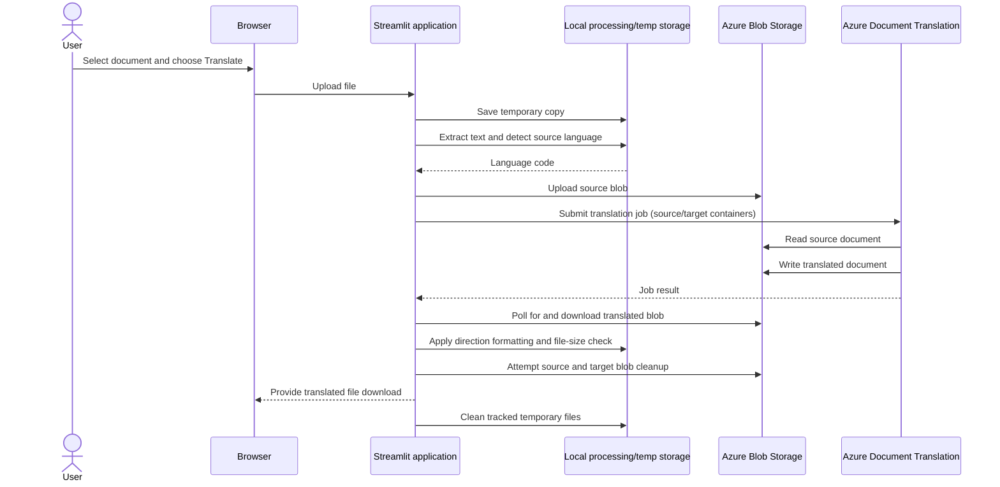

# Data flow

## Upload, translation, and download

## Detailed stages

1. **Upload.** The Streamlit file uploader accepts PDF, DOCX, XLSX, PPTX, PNG, and JPG/JPEG at the UI level. The translation path validates document extensions and enforces a 150 MB application-level limit. Image inputs are routed through OCR before translation; image support depends on the OCR path.
2. **Local extraction and language detection.** The application extracts document text locally, normalizes whitespace, and detects the language from at most the first 1,000 characters. It selects Arabic as the target only when the detected source is English; other detected codes map to English.
3. **Optional OCR.** Scanned PDFs and images can be processed using PyMuPDF and Tesseract. The OCR output is a searchable PDF. OCR depends on an installed Tesseract binary and language data; these are not correctly provisioned in the checked-in Dockerfile.
4. **Source upload.** `AzureClient` uploads the file to the fixed `source` container, overwriting a blob with the same name if one already exists.
5. **Translation.** The application submits the source and target container URLs to Azure AI Document Translation and waits for the poller result. A glossary container URL is constructed, but glossary use is commented out in the translation implementation.
6. **Download and post-processing.** The application polls the target container for the matching filename, downloads the translated blob to a local temporary path, applies right-to-left formatting for Arabic or left-to-right formatting otherwise, then checks the output-to-input file-size ratio.
7. **Blob cleanup and user download.** After the translated blob has been downloaded from Azure to application-local temporary storage, the translation handler calls cleanup for the source and target blobs. This happens before Streamlit exposes the local output through a browser download button; it does not wait for confirmation that the user downloaded the file to their own device. Blob deletion is best effort: cleanup errors are caught and printed, and success is not verified or durably recorded. Streamlit then exposes the output through a download button. For PDF downloads it also attempts a PDF-to-DOCX conversion and packages successful outputs into a ZIP.

## Data location and retention

| Data | Processing/location in current code | Retention behavior |
|---|---|---|
| Uploaded document | Browser-to-Streamlit upload and local temporary file | Tracked temporary directories are cleaned during the application cleanup path; no durable local retention policy is defined. |
| Source document blob | Azure Blob Storage `source` container | Cleanup is attempted after the translated file is downloaded to application-local storage, before the user downloads it in the browser; deletion is not guaranteed if cleanup fails. |
| Translated document blob | Azure Blob Storage `target` container | Cleanup is attempted by matching filename after the translated file is downloaded to application-local storage, before the user downloads it in the browser; deletion is not guaranteed if cleanup fails. |
| Extracted text | In process memory for language detection | No application database or persistent text store is defined. |
| OCR intermediate and output | Application host temporary storage | Tracked paths are cleaned where registered; not every intermediate path is tracked. |
| Authentication state | Streamlit session and browser storage/cookie | Browser-side persistence is not a secure server-side session mechanism. |

The code does not define encryption policies, a formal retention schedule, or a user-facing data deletion guarantee. Azure storage encryption and transport protections must be verified in the actual Azure resource and deployment configuration.
