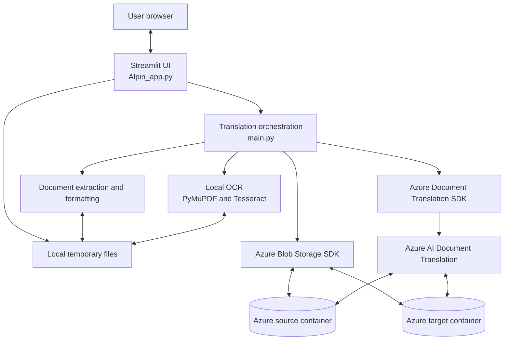
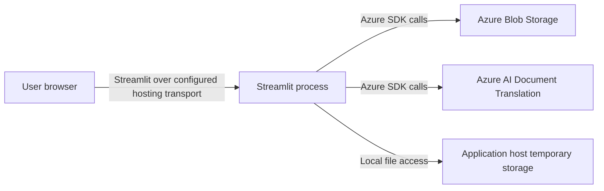

# System architecture

## Overview

The repository implements a single-process Streamlit application for document translation and OCR. `Code/Alpin_app.py` owns the browser UI and invokes orchestration in `Code/main.py`. The application uses local Python libraries for extraction, OCR, formatting, and temporary-file handling, and calls Azure AI Document Translation and Azure Blob Storage through their SDKs.

There is no separate backend API, database, queue, or verified Azure-hosted deployment configuration in the repository.

## Components and responsibilities

| Component | Responsibility |
|---|---|
| Streamlit UI (`Alpin_app.py`) | Login screen, uploads, translation/OCR actions, progress messaging, and browser downloads. |
| Translation orchestration (`main.py`) | Validates files, determines language direction, coordinates Azure upload/translation/download, and post-processes output. |
| Document processing (`document_processing.py`) | Extracts text from supported document formats and adjusts selected RTL/LTR formatting. |
| OCR (`pdf_ocr_converter.py`) | Uses PyMuPDF and Tesseract to create a searchable PDF from scanned content. |
| Azure Blob client (`azure_client.py`) | Uploads source files and reads/deletes source and target blobs. |
| Translation client (`translation.py`) | Starts and waits for Azure Document Translation jobs. |
| Configuration (`config.py`) | Reads Translator and Storage configuration from environment variables and a dotenv file. |
| Temporary-file manager (`temp_management.py`) | Creates and tracks temporary local paths for uploaded and processed content. |
| Language utilities (`language_utils.py`) | Detects a source language from extracted text and maps it to English or Arabic. |

## Component diagram

## Deployment view

The Dockerfile declares a Python container and port `8501`, but its command references `setec_app.py`, which is not present. The application entry point in the repository is `Alpin_app.py`. No Azure App Service, Container Apps, AKS, networking, identity, or infrastructure-as-code configuration is present. Azure hosting is therefore not established by the repository.

## Communication and trust boundaries

1. The browser sends an uploaded file to Streamlit.
2. Streamlit saves or retains the file in application memory and local temporary storage.
3. The application extracts enough text locally for source-language detection. English is translated to Arabic; any other detected code is mapped to English.
4. The Azure Blob SDK uploads the original document to the configured source container.
5. The Azure Document Translation SDK submits a job targeting the configured target container and waits for its result. The translation service reads from and writes to Blob Storage using the supplied container URLs and SAS credential.
6. The application downloads the translated blob, applies local formatting adjustments, and performs a file-size-ratio check.
7. Streamlit sends the resulting file bytes to the browser download control. Application cleanup attempts to remove the matching source and target blobs and tracked temporary resources.

The application does not define its own REST endpoints. Service communication is through Azure SDKs; the SDKs make service API calls. Authentication to Azure uses a Translator key and a Storage SAS token configured by the application. User authentication is implemented in the Streamlit layer and is not delegated to an identity provider.

## Scalability and reliability considerations

- Translation work is performed in the Streamlit application process and waits on the Azure translation poller. There is no job queue, worker pool, or persistent job state.
- Blob names are based on the input filename and uploads overwrite existing blobs. Parallel requests with identical names can collide.
- Local temporary files and session state are process-local; they do not provide durable recovery after a restart.
- A missing translated blob is retried with exponential delays, but broader retry, idempotency, and rate-limit policies are not defined.
- The configured upload size limit is 150 MB in application logic, while the Dockerfile separately sets Streamlit's upload limit. These values should be kept aligned.
- Production scaling would require unique per-request blob paths, isolation between users, managed identity or narrowly scoped secrets, durable job tracking, observability, and tested deployment health checks.
